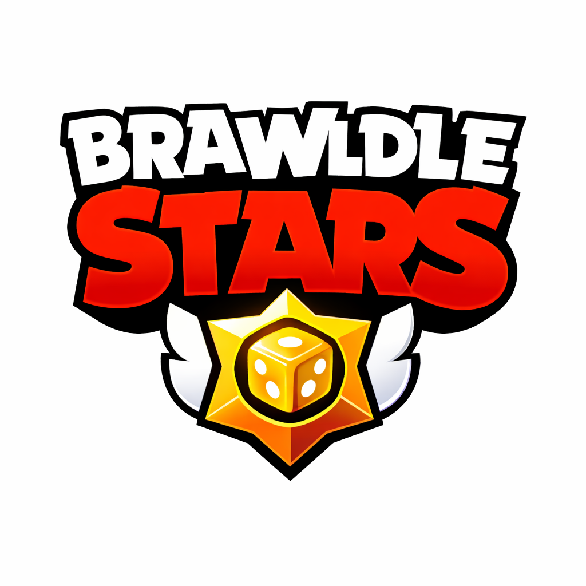

# Brawldle Stars



[Brawldle Stars](https://nicolasporot.github.io/brawldle-stars/index.html) is a daily guessing game inspired by [Wordle](https://www.nytimes.com/games/wordle/index.html), based on **Brawl Stars**.

Every day, players can challenge themselves through several game modes and try to identify the correct Brawler using different types of clues.

---

## Link 

You can play [here](https://nicolasporot.github.io/brawldle-stars/index.html)

---

## Game Modes

Brawldle currently features several game modes:

### Classic

Guess the hidden Brawler using multiple characteristics:

* Gender
* Rarity
* Class
* Attack range
* Movement speed
* Release year

Each guess provides feedback to help narrow down the correct answer.

### Gadget

Identify the Brawler associated with a hidden Gadget.

### Star Power

Identify the Brawler associated with a hidden Star Power.

### Skin

Guess the Brawler from one of their Skins. The image progressively becomes clearer as you make guesses.

### Hypercharge

Identify the Brawler associated with a Hypercharge using its name and description.

### Emojis

Guess the Brawler represented by a combination of four emojis.

### Mystery

Identify the Brawler from a mysterious Skin.

### Buffie

Guess the Brawler associated with a Buffie.

### Icon

Identify the Brawler from their profile icon.

### Description

Guess the Brawler from their character description.

### Title

Identify the Brawler from their Title or Prestige Title.

### Spray

Guess the Brawler from one of their Sprays.

---

## Daily Challenge

The game uses a daily schedule system.

Each day, **8 game modes** are selected automatically:

* Classic is always included in slot 1.
* The remaining modes are randomly selected from the enabled modes.
* The correct result is randomly selected according to the type of game mode.

---

## Tech Stack

### Frontend

* HTML
* CSS
* JavaScript

### Backend / Database

* [Supabase](https://supabase.com/)
* PostgreSQL
* Supabase REST API

### Assets

Game assets are stored locally and organized by category, including:

```text
assets/
├── brawlers/
├── brawlers_profile_icon/
├── brawlers_spray/
├── brawlers_star_power/
├── design/
├── gamemode/
└── ...
```

---

## Database

Brawldle uses a PostgreSQL database hosted on Supabase.

### Main tables

#### `brawler`

Contains the information associated with each Brawler.

#### `ability`

Contains Brawler abilities such as:

* Gadgets
* Star Powers
* Hypercharges
* Buffies

Each ability is associated with a Brawler through brawler_id.

#### `skin`

Contains the available Brawler Skins.

#### `game_mode`

Defines the available game modes and their result sources.

#### `daily_schedule`

Stores the game modes and answers selected for each day.

---

## Daily Schedule Generation

The daily schedule is generated using a PostgreSQL function.

It:

1. Deletes the existing schedule for the current day.
2. Selects a random Brawler for Classic.
3. Selects 7 additional enabled game modes.
4. Selects an appropriate result depending on the mode.
5. Inserts the 8 results into `daily_schedule`.

---

## Gameplay

The main gameplay logic is handled by:

```text
gameplay.js
```

The script is responsible for:

* Loading Brawlers from Supabase
* Loading the daily target
* Detecting the current game mode
* Managing guesses
* Managing autocomplete
* Rendering results
* Managing game clues
* Handling win states
* Managing Skin image blur
* Displaying the final score

The game determines the target based on the `game_mode.result_source`.

---

## Local Development

Clone the repository:

```bash
git clone <repository-url>
cd brawldle-stars
```

Because the project uses frontend JavaScript and local assets, it is recommended to run it through a local development server rather than opening the HTML files directly.

For example, with VS Code and the **Live Server** extension:

```text
Right click index.html
→ Open with Live Server
```

---

## Features

* Daily challenges
* Multiple game modes
* Brawler autocomplete
* Guess history
* Progressive clues
* Daily randomization
* Skin blur progression
* Score tracking
* Supabase database integration
* Responsive interface
* Local game assets

---

## Roadmap

Potential future improvements:

* Statistics and player history
* Streak system
* Leaderboards
* More game modes
* Shareable daily results
* User accounts
* Achievement system

---

## Credits

Brawldle is an independent fan-made project inspired by the concept of daily guessing games.

**Brawl Stars** and its characters, images, names and related assets are properties of **Supercell**.

Brawldle is not affiliated with or endorsed by Supercell.

---

## License

This project is intended for educational and personal use.

Game assets and Brawl Stars intellectual property remain the property of their respective owners.
